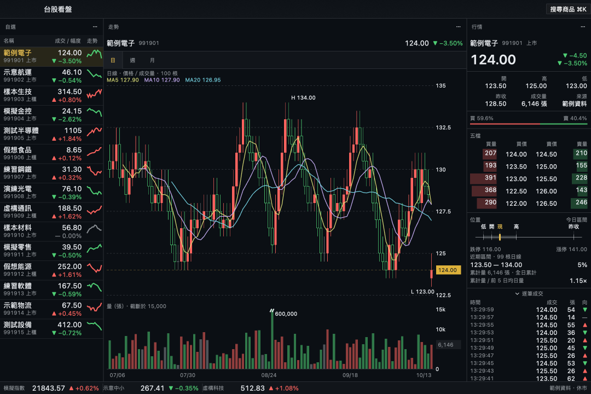
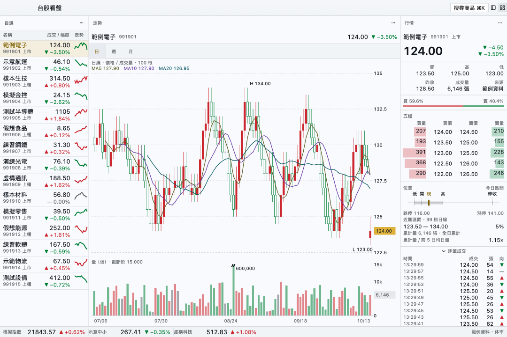
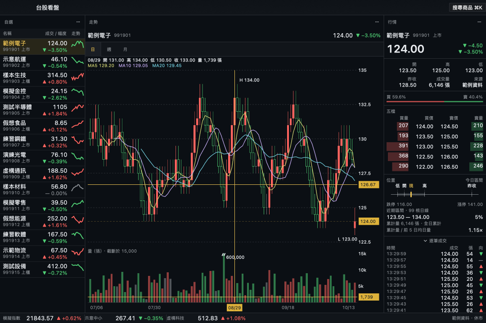
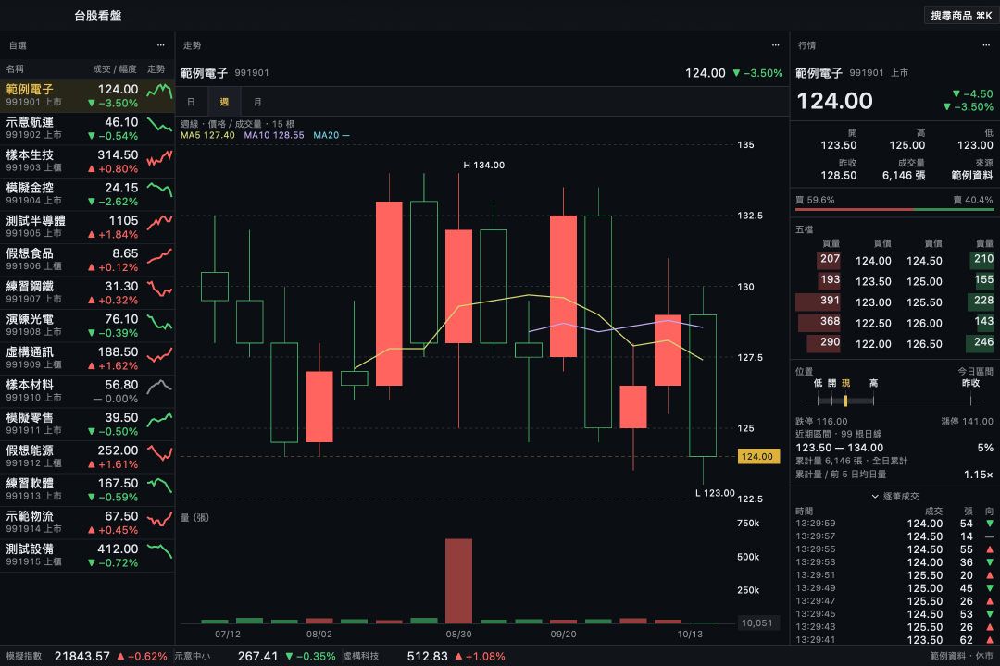
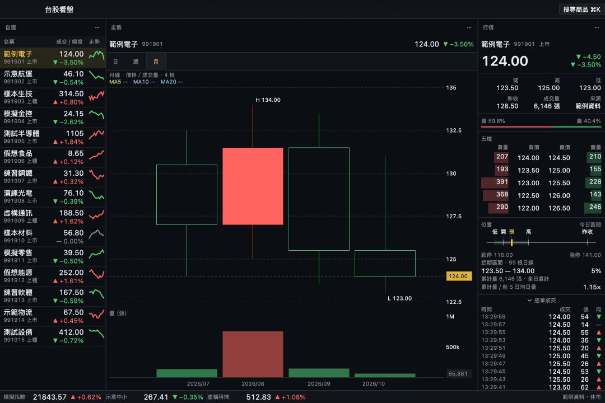

# twstock-gpui

[繁體中文](README.md) · English

A desktop watch app for Taiwan stocks, for personal use. Native macOS, built with the GPUI components of [gpui-kit](https://github.com/longbridge/gpui-kit). Not a web app.



Screenshots use invented sample data (fictional instruments with codes starting 99), not real quotes.

## Features

- **Three-column workspace:** watchlist (with sparklines), chart, and quote detail (order book, buy/sell ratio, volume and position). Panels can be dragged and resized.
- **Position block** under the order book: today's price range bar (low, high, previous close, open, gold last price; limit-up/limit-down are labelled below the axis), the percentile of the last price within the loaded daily range, and today's cumulative volume against the average of the previous 5 days. With no trade price, no last price is drawn and a reference price is labelled as such. When the source has no tick-by-tick trades, that section takes no space. The quote panel scrolls in small windows.
- **Chart** drawn with gpui-kit's plot components: candles (solid when the close is up, hollow when down, so direction does not rely on colour alone), MA5 / MA10 / MA20, a volume sub-chart, a gold crosshair with axis labels, high/low marks, and a last-price line.
- **Zoom / pan:** vertical scroll or trackpad pinch zooms at the cursor; horizontal scroll or left-button drag pans. Double-click, switching instrument, or switching period resets to the full series.
- **Volume clipping:** a robust ceiling `nice(P95 × 1.2)` is applied only when one extreme bar would flatten the rest, that is, when the visible maximum exceeds 2.5× the ceiling. Clipped bars show a break mark and the true volume; the title reads "clipped at N". The crosshair still reads the raw volume. Day, week and month share the rule.
- **Volume numbers:** lots are rounded to whole lots with thousands separators; axis ticks keep `k` / `M` abbreviations. With the cursor on a bar, the right axis of the volume chart shows that bar's actual volume; without a cursor, the latest volume is shown faintly. Date, price and volume labels avoid axis ticks.
- **Panel states:** loading shows a centered spinner with a muted note, failures include the reason, and empty or too-small panels are centered in the content area. "0 daily bars" is never shown while the recent range is still loading.
- **Taiwan colour convention:** red up, green down, flat is grey. Prices and numbers are always neutral; only change is coloured.
- **Day / week / month** periods. Week and month are aggregated from the loaded daily bars, with no extra requests. Switching instrument keeps the current period; it is not saved across restarts. There are no free minute bars, so no disabled minute option is shown.
- **⌘K search:** add an instrument by code prefix or name substring. Up/Down to select, Enter to add, Esc to close. Already-added and over-the-subscription-limit cases are reported explicitly.
- **Dark and light** themes.
- **Connection state** is always visible: connecting, ok, stale, failed, market closed. A dropped connection is never shown as flat.









## Data sources

| Use | Source | Limits |
|---|---|---|
| Live quotes and order book | TWSE MIS (`mis.twse.com.tw`) | Unofficial endpoint, no guarantees. Updates about every 5 seconds; the app polls no faster than every 5 seconds. No tick-by-tick trades. The last-price field is often `-`. |
| Daily history | TWSE `STOCK_DAY` | One month per request, back-filled to 100 bars, at most 12 months back. Listed (TSE) only; OTC history is not wired up yet. |
| Instrument list | TWSE ISIN lists, listed `strMode=2`, OTC `strMode=4` | Only the official "stock" and "ETF" categories. The category decides the ETF tick size; the code prefix is never guessed. |

Personal use only. Not investment advice, and the data is not guaranteed to be correct or real-time. Please do not raise the polling rate.

Without a config file the app uses fixed-seed sample data, so you can try it on any machine.

## Requirements

- macOS with Metal. Only verified on Apple Silicon.
- Full Xcode (not just the Command Line Tools) with the Metal toolchain installed:

  ```sh
  sudo xcode-select -s /Applications/Xcode.app/Contents/Developer
  sudo xcodebuild -license accept
  xcodebuild -runFirstLaunch
  xcodebuild -downloadComponent MetalToolchain
  ```

- [rustup](https://rustup.rs). `rust-toolchain.toml` pins 1.97.1 and installs it on the first build.
- The system `curl` (used for quote requests).

## Run

```sh
git clone <this repo>
cd twstock-gpui
cargo run --release
```

Run it in a desktop session with a display; a window cannot be opened over SSH. The first build takes a few minutes.

### Watchlist

Create `~/.config/twstock-gpui/watchlist.toml`; only when it is absent does the app read the legacy `~/.config/twstock-gpui/watchlist.toml` in place, with additions/removals written back to the loaded file without copying or moving it:

```toml
[[watchlist]]
market = "tse"   # tse = listed, otc = OTC
code = "889901"   # sample code, replace with the one you want to watch

[[watchlist]]
market = "tse"
code = "889902"
```

- No file: sample data is used.
- Malformed file: a failure is shown; the app does not silently fall back to sample data.
- This file lives only on your machine, not in the repo.
- You can also press ⌘K (or "Search instruments" in the title bar) to add one. Adding the first instrument from sample mode explicitly tells you that a config is being created and live MIS quotes are being switched on; sample instruments are never written to the config.
- Select a row in the watchlist and press Delete / Backspace, or use "…" next to the watchlist title → "Remove selected". Adds and removals on a real watchlist are written back atomically with `toml_edit`, keeping comments and formatting of what remains. Existing aliases such as `[[watchlist]]` and `[[symbol]]`, and inline arrays, are supported.
- An empty list is saved as an empty list and does not fall back to sample data on restart. Removing a sample instrument only affects the current session and is never written to a real watchlist.
- Subscription changes take effect on the provider's next request round, with no restart; the minimum 5-second polling interval still applies. Reordering is not available yet.

### How position figures are defined

- The range axis uses only the known low, high, previous close, last price and open, with 8% of the span as padding on each end (at least one tick); a flat range still gets a readable span. A previous close outside the day's range is still included; a reference price is not. Labels are measured with their real width, spread apart, and connected back to their price by leader lines; marks and axis share one scale. Limit-up and limit-down are labelled only at the two ends below the axis and do not compress the day's range.
- The recent range uses only the low/high of the loaded daily bars and shows the actual bar count. No data is invented, and it does not change when switching to week or month. The last-price percentile is clamped to 0–100%; equal high and low with an equal last price gives 50%; with no trade price it is `—`.
- The volume ratio's denominator is the 5 most recent complete daily bars before the quote date; today's unfinished bar is not averaged in. With fewer than 5 bars, a zero average, or no volume or quote date for today, it shows `—`; zero volume today may show `0.00×`.
- During the session or in an unknown session it is labelled "intraday cumulative"; after the close or on a closed day, "full-day cumulative". It is not a same-time-of-day ratio, does not scale by elapsed trading time, does not project full-day volume, and draws no surge/dry-up conclusion on its own.
- The volume chart's P95 uses nearest-rank (the `ceil(0.95 × count)`-th value in ascending order, zeros included). With fewer than 20 bars, P95 equals the maximum, so the full volume axis is kept. Week and month charts always show the full true volume, even when not clipped.

### Period and search data

- Weeks are grouped by the ISO week of the trading day (ISO week-year across new year); months by year and month. Open is the first day's, close the last day's, high and low the extremes, and volume the sum. The known live bar for today is included in the unfinished period. A mid reference price used when there is no trade price is never used to build a bar.
- MA5 / 10 / 20 are recomputed for the current period and show `—` when there are too few bars. The date axis is `MM/DD` for day and week and `YYYY/MM` for month. The chart info row shows the actual bar count; months are not padded. With mock data there are 15 weekly and 4 monthly bars, so the monthly MA stays blank (fewer than 5 bars). In a real-data run on 2026-10-15, all three instruments had 22 weekly and 6 monthly bars; monthly MA10 / 20 still lack bars.
- Search ranking: exact code or name match → code prefix → name substring; ties are broken by code, then market code. Name matching ignores letter case.
- The list is kept in memory and cached on disk at `~/.cache/twstock-gpui/directory.json` with its fetch time, and refetched after 24 hours. Expiry is also checked each time search is opened again; a failure shows its reason, and neither a fake list nor an expired cache is used.

## Verification

```sh
cargo clippy --all-targets -- -D warnings
cargo test
cargo test --test rendering
```

- `cargo test --test rendering` renders off-screen on the GPU without opening a window, writes `/tmp/twstock-gpui-*.png`, and checks pixels, layout bounds, selection, and panel dragging and resizing. It runs over SSH. It always uses sample data, does not read your config, and does not touch the network.
- Ten static scenes are also compared against golden PNGs in `tests/snapshots/`: dark, light, crosshair, dark-small, weekly, monthly, position, volume-clip, zoomed-in, panned-to-left. Both the render and the golden are box-filtered down by 2×2. A per-channel difference of at most 2 is ignored; more than 0.05% differing pixels fails, and the dimensions must match. The loading spinner and the palette's blinking caret are not included. Text rendering can differ across OS / font / GPU, so look at the images before updating.
- To update the goldens: `UPDATE_SNAPSHOTS=1 cargo test --test rendering`, then review the PNGs and the diff. Without that flag, a missing golden also fails. Diff and actual images are written to `/tmp/twstock-gpui-snapshot/<name>.diff.png` and `<name>.actual.png`. The comparator's unit tests run with `cargo test`; the GPU snapshots still need the rendering command above.
- Network tests are off by default. To smoke-test the real sources once:

  ```sh
  TWSTOCK_GPUI_LIVE=1 cargo test --test live_shot
  ```

  It reads your `watchlist.toml`, loads the instrument list to get the right instrument types, writes `/tmp/twstock-gpui-live-{dark,light}.png`, and lists the actual day / week / month bar counts for each instrument. Real responses are never written into the repo.

  To check the two market endpoints of the instrument list on their own (forces a live fetch and reports count and duration):

  ```sh
  TWSTOCK_GPUI_LIVE=1 cargo test --test directory directory_live_opt_in -- --nocapture
  ```

  Rendering also writes `/tmp/twstock-gpui-position.png`, `/tmp/twstock-gpui-volume-clip.png` (mock workspaces with the position block and a single-bar spike clip), `/tmp/twstock-gpui-position-outside.png` (an invented previous close outside the day's range), `/tmp/twstock-gpui-weekly.png`, `/tmp/twstock-gpui-monthly.png` and `/tmp/twstock-gpui-palette.png`, all with invented data. It also verifies search, keyboard add, duplicate / over-limit, removal and the empty list.

## Layout

```
src/
  design/    the only source of visuals: palette, type roles, direction (up/down), spacing, radii, parts, charts
  market/    market domain types, MarketStore, MIS and history providers, config. Does not depend on gpui
  panels/    watchlist, chart, quote, status bar. Calls design only and decides no visuals itself
tests/
  design_rules.rs        scans code outside design and fails on hard-coded colours, type sizes, weights, spacing or radii
  provider_conformance.rs  behaviour tests shared by all providers
  rendering.rs / live_shot.rs  off-screen rendering
```

- **Design guideline:** nothing outside design may decide visuals; the `design_rules` test enforces it.
- **Market interface:** the UI depends only on the domain types and `MarketStore`. To add another source (a broker API, a websocket), implement a provider and pass `provider_conformance`; the UI does not change. Prices are fixed-point (unit 0.0001), and the tick size belongs to the instrument (ETFs and stocks differ).

## Known limitations

- Market closure is inferred from Taipei time, weekends and the source date; the official trading calendar is not wired up yet.
- MIS has no tick-by-tick trades, so that source shows no trade-list section; the mock still keeps a collapsible trade list.
- OTC daily history is not wired up. For new listings or short histories, the position block shows the real bar count and the 5-day average volume shows `—` when short; filling 100 bars is not guaranteed.
- Position reflects only the data the source provides and the app has loaded; the volume ratio has no intraday time-of-day correction, and daily and live volume may update at different times at the source.
- No minute bars. Daily history is still at most 12 months back and 100 bars are loaded, so week and month histories are short and monthly charts usually lack the bars needed for MA10 / 20.
- Instrument search covers only the official "stock" and "ETF" categories; warrants, preferred shares, the Innovation board, ETNs, TDRs and beneficiary securities are not included, to avoid guessing tick sizes.
- The instrument list and quotes still depend on external sources; when the cache has expired and a refresh fails, the search panel shows the failure.
- Verified on macOS only, and with no long-running soak test.

## License

[Apache-2.0](LICENSE). The gpui-kit it uses is also Apache-2.0.

The license covers the code in this repo only. Use and redistribution of TWSE market data are governed separately; check with TWSE before any commercial use.
